# M3 implementation report — AI and organizer intelligence

| | |
| --- | --- |
| Milestone | M3 — AI and organizer intelligence |
| Status | Complete. **Awaiting independent review.** M4 not started. |
| Baseline | `ff445ea` (M2 + CI fix) |
| Report date | 2026-11-28 |
| Runtime AI | **Not connected.** No Anthropic credentials are configured; no credits were spent. Every AI path is implemented and tested with a scripted provider; the running app uses its deterministic fallbacks and says so. |

Related: [ai-actions.md](../ai-actions.md), [ADR-0008](../adr/0008-ai-gateway.md), [ADR-0009](../adr/0009-business-action-registry.md),
[ADR-0010](../adr/0010-grounded-demand-analysis.md), [architecture.md § Organizer interface](../architecture.md#organizer-interface-m3),
[security.md](../security.md), screenshots in [`m3/`](m3/).

---

## 1. What was built

| Area | Delivered |
| --- | --- |
| Demand signal capture | Waitlist ("Notify me") on sold-out items, sold-out views (reported after the page is shown), searches that found nothing (catalogue and concierge; re-checked on the server; the concierge stores parsed intent, not free text). Subjects are keyed hashes; signals are idempotent per person (per day for views/searches) and tenant-pinned by composite FKs. |
| Organizer analytics | `/organizer`: live vs seeded revenue, tickets, orders, open opportunities, pending approvals, sell-through per event. `/organizer/events/:id`: per-item capacity, sold, live/seed revenue and unique interest. |
| Unmet-demand analysis | Pure rules turn a sold-out session with enough distinct interest into a second-session proposal (capacity, price, DST-safe slot, maximum gross, 25/50/75 % scenarios, risks). The seeded scenario reproduces the brief's example exactly: **384 interested → 150 places at EUR 35 → EUR 5,250 maximum gross**. |
| Recommendations | Evidence, proposed action, revenue assumptions, risks and a brief. Briefs are rules text; a model-written brief is stored only if every number in it belongs to the recommendation. After publication the card shows **actual** live sales against the low estimate. |
| Business Action Registry | Six typed actions with risk, permission, approval policy, rate limit, idempotency contract, binding and preconditions; one executor for UI, API and AI tools; denials audited; effects audited with `actor_type` user / ai_agent / system. |
| Approvals | `/organizer/approvals`: exact parameters (title, event-local start, places, price) and their hash; approve/reject with a note; approval executes once; history; outcome banner read back from the stored request. |
| AI Gateway | Provider-neutral types, Anthropic adapter (official SDK), budget check before every call, deadlines and per-call timeouts, one retry, bounded tool loop, schema-validated final answer, usage and integer micro-USD cost ledger, sanitized logs, typed failures. Opus ids are rejected. |
| Concierge | On home and Discover. With AI: a tool loop over the two public read-only actions; picks filtered to what the tools returned; cards rendered from the database. Without AI (now): deterministic intent parsing (kind, city, month, budget, keywords) through the same `events.search` action. Labelled "AI picks from live listings" or "Plain search · no AI involved". |
| Organizer agent | "Let the agent prepare it": with AI the model calls `experience.create_draft` and `experience.publish` (which waits for approval); without AI a fixed automation makes the same two governed calls. The card then shows who prepared it and links to the approval. |
| Seed data | 593 seeded demand signals (Sunset Sessions scenario plus three platform searches), `origin = 'seed'`, deterministic. |

The flagship loop works end to end in the real interface and is covered by Playwright on desktop and mobile:
unmet demand → analysis → agent draft (private) → publication request → human approval of exact parameters →
on sale on the public event page → actual sales attributed to the recommendation.

## 2. Schema and migrations

| Migration | Content |
| --- | --- |
| `0006_intelligence` | `demand_signals`, `commercial_recommendations`, `action_requests`, `ai_usage_records`; enums; composite tenant FKs; partial unique indexes (signal dedupe, one open request per action/tenant/hash); checks (hash format, decision fields, executed_at). |
| `0007_action_request_guards` | Trigger: params, hash, requester, initiator, risk and decision immutable; forward-only transitions; no deletes. |

`events` services now accept an open transaction and an audit attribution (so an approved action's effect and its
`executed` flip commit together). No applied migration was edited.

## 3. Screenshots (production build)

Captured by `CAPTURE=1 pnpm exec playwright test organizer-journey` against `next start`. Each run builds its own
fixture tenant (sold-out 10-place session, 30 interested people), so figures differ from the seeded festival.

| | Desktop | Mobile |
| --- | --- | --- |
| Concierge (plain-search mode) | 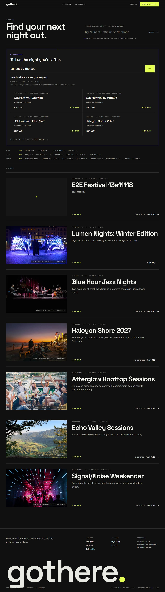 |  |
| Organizer overview | 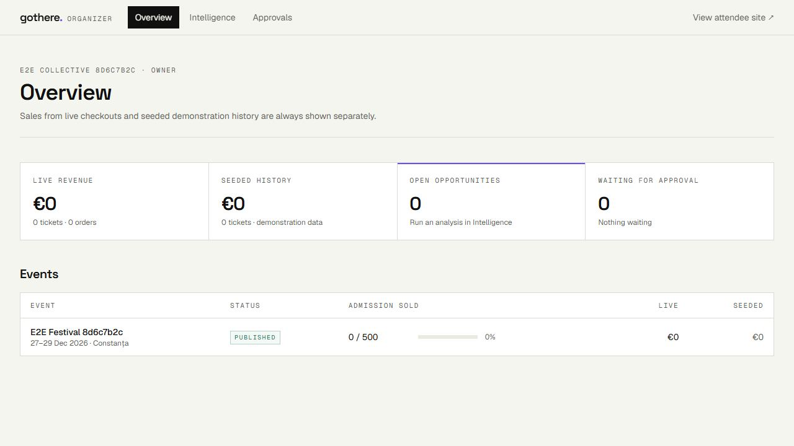 | 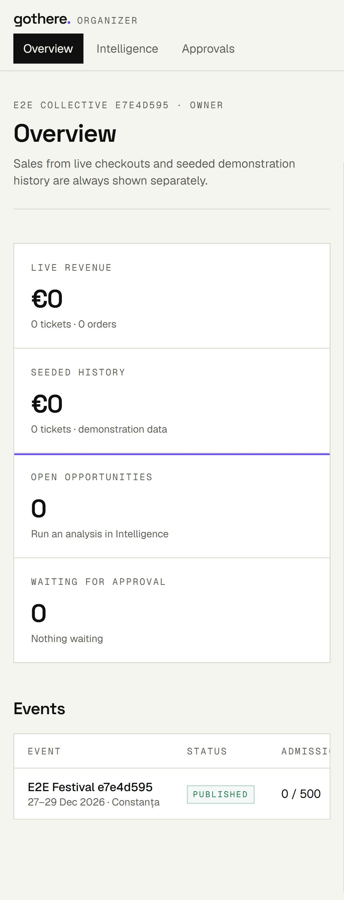 |
| Intelligence: recommendation | 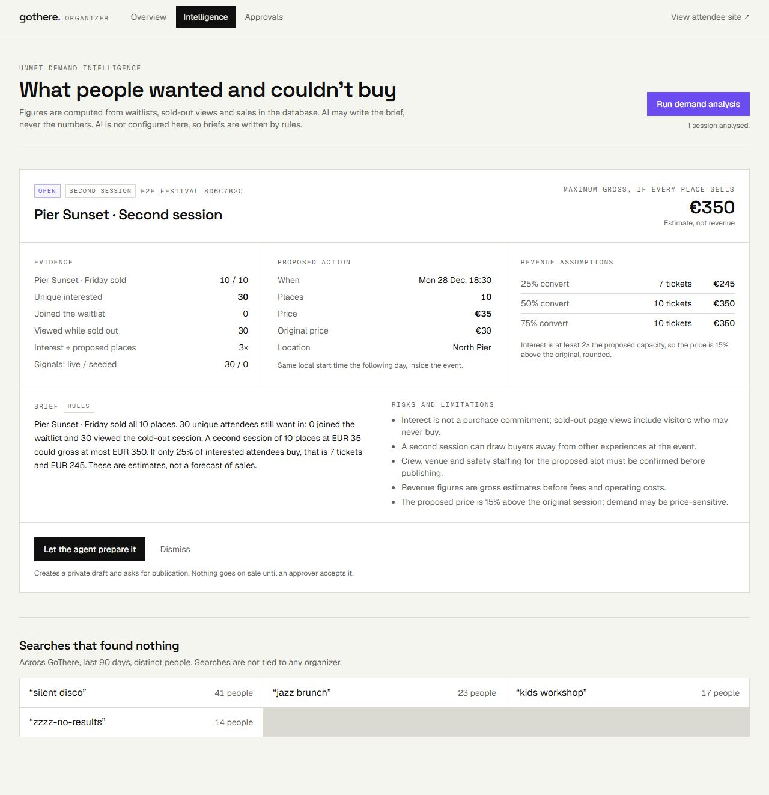 | 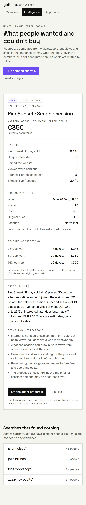 |
| Approval inbox | 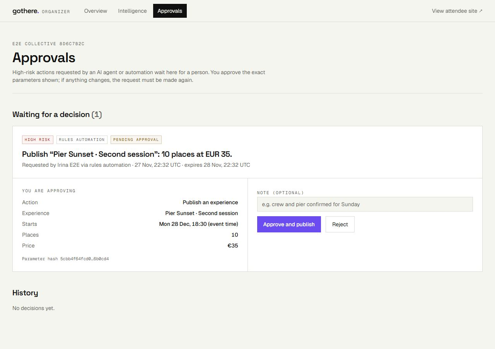 | 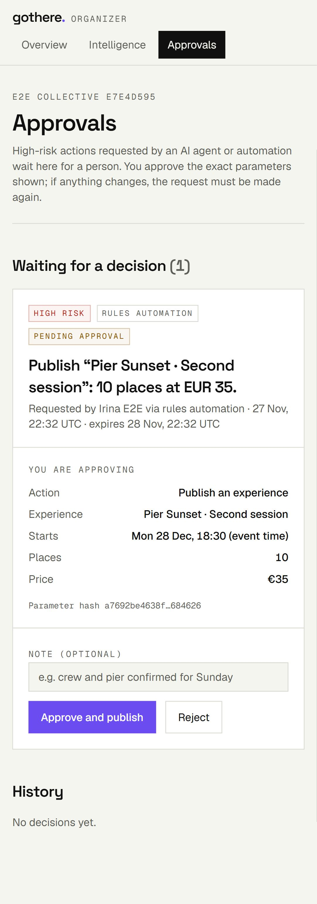 |
| After approval | 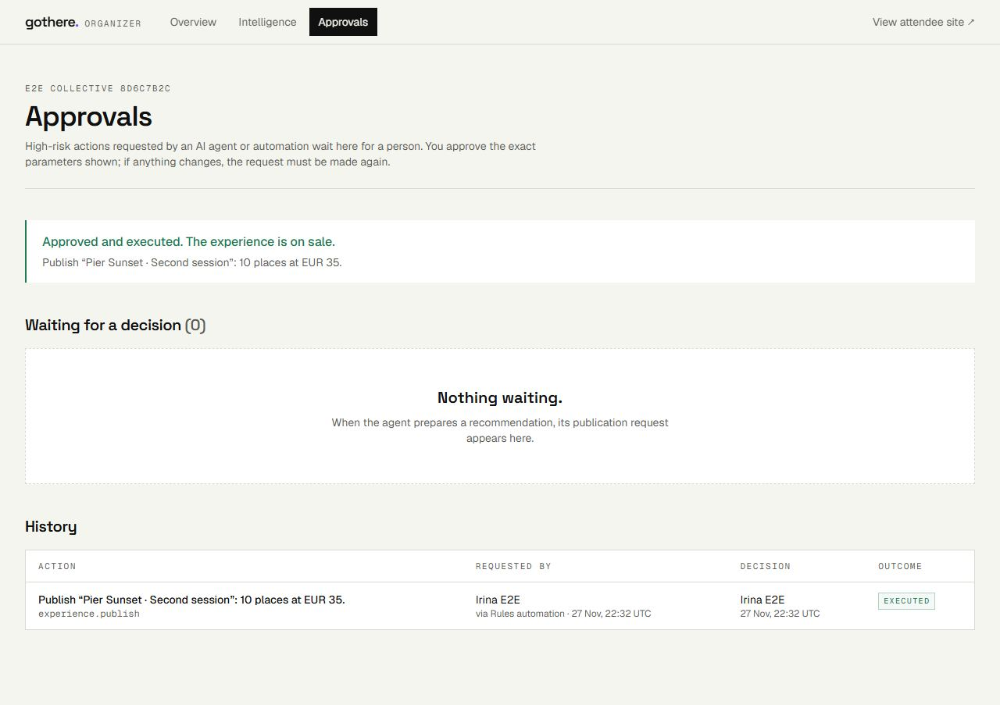 | 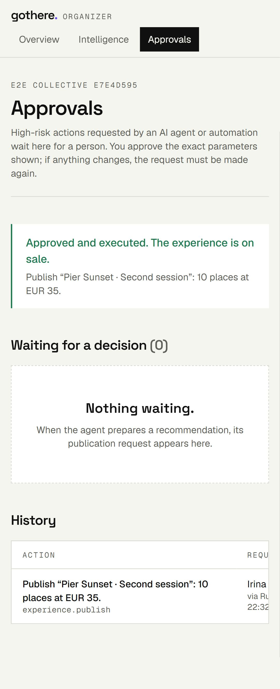 |
| Published: actual vs estimate | 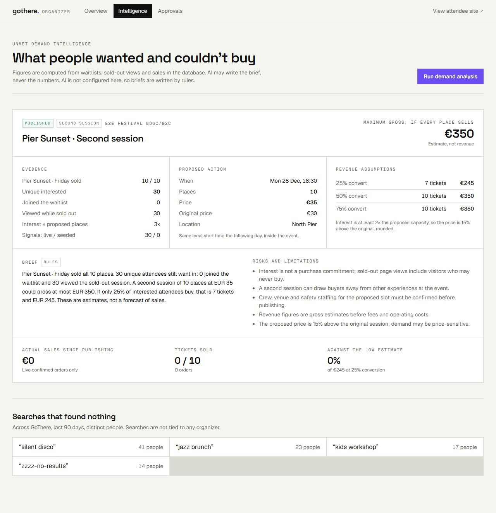 | 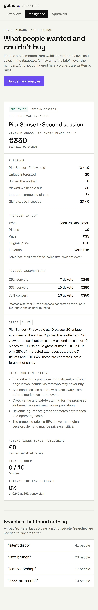 |

## 4. Dependencies introduced

| Package | Why |
| --- | --- |
| `@anthropic-ai/sdk` 1.14.0 | Official SDK for the gateway's Anthropic adapter (required by the brief). Imported only by `src/ai/providers/anthropic.ts`; domain code is barred from it by `domain-no-frameworks`. |

## 5. Automated test results

| Gate | Result |
| --- | --- |
| `pnpm check` (typegen, tsc, lint, boundaries: 180 modules, 0 violations, unit) | Pass |
| Vitest unit | **40 / 40** (8 files) |
| Vitest integration (real PostgreSQL) | **126 / 126** (13 files) |
| Playwright (`pnpm build && pnpm test:e2e`), dev data | **42 passed**, 12 skipped by design |
| Playwright on CI-mirrored data (integration fixtures + seed in `gothere_test`) | **42 passed** twice in a row |
| Build | Pass; all organizer routes Partial Prerender |

Mandatory scenarios from the brief:

| Scenario | Test |
| --- | --- |
| Unauthorized AI actions are rejected | `governed-actions › rejects actions from non-members and from roles without the permission, and audits the denial`; `› pins resources to the context tenant…`; `› rejects unknown keys…`; `ai-gateway › treats the attendee message as data…` (injected publish → `UNKNOWN_TOOL`) |
| High-risk AI actions require approval | `governed-actions › lets an agent create a private draft but holds publication for a human`; `› holds publication of manually created drafts too…`; `ai-gateway › lets the agent draft and request publication, but never publish` |
| Approved parameters cannot be manipulated | `› rejects an approval for parameters other than the ones reviewed`; `› makes stored parameters immutable in the database`; `› refuses to publish a draft that changed after the request…` |
| Approval replay is rejected | `› executes exactly the approved parameters, once…` (replay of execute and decide); `› executes an approved request exactly once under concurrent execution` (5 parallel) |
| AI provider failure does not interrupt ticketing | `ai-gateway › falls back to deterministic search when the provider fails, and ticketing is unaffected`; `› answers without any provider configured…`; e2e asserts the browser never contacts a provider |
| Cross-tenant access is rejected | `› pins resources…`, `demand-signals › rejects a signal whose event belongs to a different tenant` |
| Budget | `ai-gateway › stops calling the provider once the monthly budget is spent`; `› records usage and integer cost…` |
| Grounding | unit `intelligence › only accepts narratives whose numbers come from the analysis`; `ai-gateway › keeps the rules narrative when the model cites numbers…`; `› only recommends what its tools returned and never repeats prices in prose` |
| Flagship loop (UI) | `organizer-journey › unmet demand becomes an approved, purchasable second session` (desktop + mobile, with axe on overview, intelligence and approvals) |

## 6. Problems found and fixed during verification

- A delegated recommendation's result disappeared when the page refreshed into its drafted state. The drafted
  state now shows who prepared the draft (AI agent or rules automation) and links to the approval.
- The approval success message unmounted with its card. The outcome is now a server-rendered banner from the stored
  request (`?decided=`).
- The approval inbox showed UTC while the recommendation showed event time. The approved snapshot now includes the
  event's time zone.
- The demand beacon's unread response kept the request open, so pages never reached network idle in Chromium. The
  beacon now drains the response.
- The mobile organizer header clipped "Approvals"; nav moves to its own row on small screens.

## 7. Known limitations

- **No real model has been exercised.** Concierge quality, brief quality and agent behaviour with Claude are
  untested beyond the scripted provider. Enabling needs a key, model id and budget (§9).
- One opportunity type (second session). No price elasticity, cannibalisation or capacity-cost modelling.
- Waitlist does not notify anyone yet (no email provider); it is a demand signal and a stored intent.
- Single-approver policy; the person who delegates may approve (R-21).
- Approval expiry is lazy (on list and decide); execution enforces it regardless.
- The organizer UI covers intelligence and approvals; event creation and inventory editing exist as API routes
  (M1) but have no screens yet.
- `/organizer/events` redirects to the overview (consolidated, as the brief allows).
- Local e2e runs leave fixture organizations in the dev database (their events are marked completed so they leave
  the catalogue).

## 8. Security findings

New controls are listed in [security.md](../security.md) (governed actions, AI boundary, demand data). Risk changes:
R-04 prompt injection High → Medium, R-05 approval tampering/replay High → Low, R-06 cost runaway Medium → Low
(all with tests). New: R-20 demand inflation by scripted clients (Medium), R-21 delegator can approve (Low, accepted),
R-22 concierge text goes to the AI provider when enabled (Low; privacy notice needed before launch). No critical
findings.

## 9. Decisions requested

1. Close the M3 review and authorize M4.
2. To demonstrate real AI: an Anthropic API key (server-side env only), the model id the account can use (the
   code defaults nothing; `claude-haiku-5-5` has a built-in price), and a monthly budget in US cents. Until then no
   credits are spent.
3. Whether a two-person rule (approver ≠ requester) should apply to HIGH actions.
4. Carried over: imagery hosting (R-17), Neon and Vercel credentials.
