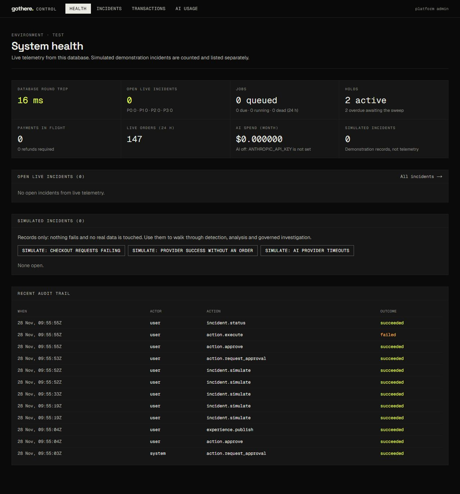
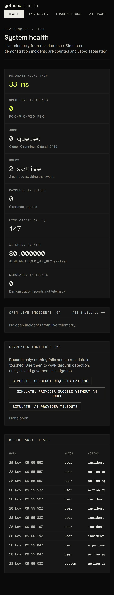
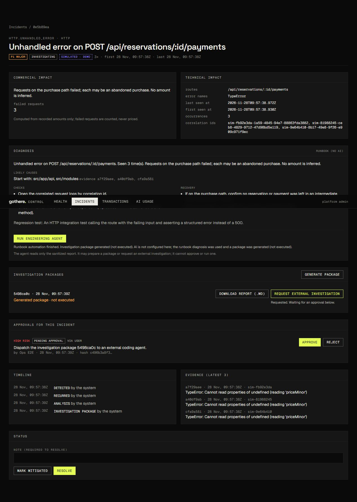
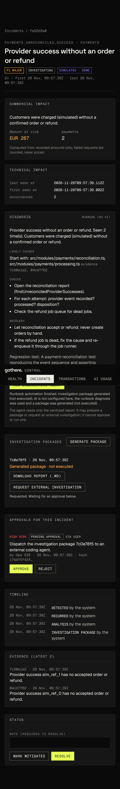
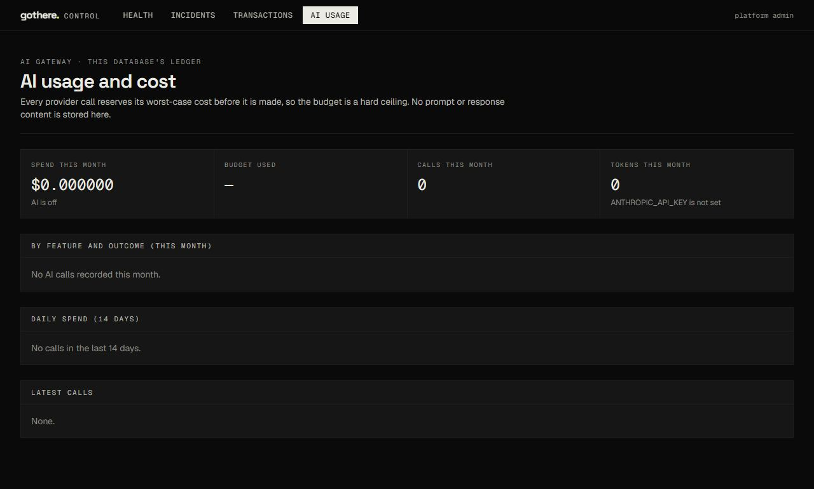
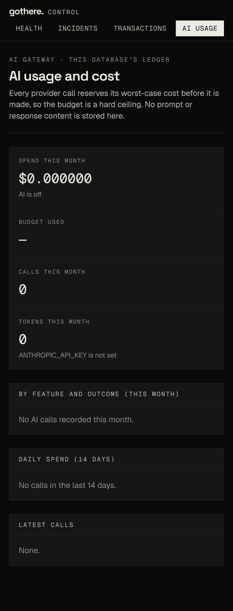

# M4 implementation report — Engineering intelligence

| | |
| --- | --- |
| Milestone | M4 — Engineering intelligence and governed engineering agents |
| Status | Complete. **Awaiting independent review.** M5 not started. |
| Baseline | `c68c899` (M3 approved) · pre-M4 hardening `9e36b4c` |
| Report date | 2026-11-28 |
| External agents | **None connected.** No Cursor credits consumed. Investigation packages are generated, never executed. |
| Real incidents triggered | None. Demonstrations use clearly labelled simulated records. |

Related: [ADR-0011](../adr/0011-pre-release-gate-and-csp.md), [ADR-0012](../adr/0012-incident-detection.md),
[ADR-0013](../adr/0013-governed-engineering-agents.md), [operations.md § Incidents](../operations.md#incidents-m4),
[security.md](../security.md), [invariants.md § M4](../invariants.md#engineering-intelligence-m4), screenshots in [`m4/`](m4/).

---

## 1. Pre-M4 hardening (requested before M4)

| Item | Result |
| --- | --- |
| `pnpm vercel:check-env` | All readable checks pass: `APP_ENV=preview`, `BETTER_AUTH_URL=https://gothere.mihaic.me`, model `claude-haiku-5-5` (not Opus), `AI_MONTHLY_BUDGET_MINOR=20`, no migrator/seed/test variables on Vercel. Five Sensitive values present but not readable by design (the live site's DB reads confirm `DATABASE_URL`). `SITE_ACCESS_PASSWORD` **not set yet** (see §8). |
| Access gate | `src/proxy.ts`: HMAC-signed HttpOnly cookie (7 days; rotating the password revokes all); pages → `/access`, APIs → 401; constant-time compare, 10 attempts / 10 min per IP, safe `next`. **Fails closed** on Vercel without a password. Ungated: `/access`, `/api/access`, `/privacy`, the HMAC payment webhook, the bearer-protected cron route. |
| CSP | On every route: `default-src 'self'`, images only self + Unsplash, `connect-src 'self'`, `object-src 'none'`, `frame-ancestors 'none'`, `form-action 'self'`, `base-uri 'self'`, `upgrade-insecure-requests` over https. Inline scripts allowed: Next documents nonces as incompatible with Partial Prerendering. No CSP violations on the main journeys (tested). |
| Privacy notice | `/privacy`, linked from footer, sign-up and the concierge; describes exactly what the code stores and sends. |
| AI spending | Concierge AI only for signed-in visitors (anonymous → plain search, tested: provider never called); organiser AI needs membership; with the gate, outsiders reach no AI path. |
| Deployment verified (`9e36b4c`) | Vercel production Ready, aliased to gothere.mihaic.me. From outside: `/` → 303 `/access`; `/api/events` and `/api/concierge` → 401 (gate); `/privacy` 200; cron → its own 401; webhook → "Invalid notification signature"; CSP, HSTS, nosniff, DENY present. |

## 2. What M4 delivers

| Area | Delivered |
| --- | --- |
| Structured operational events | `operational_events`: sanitized message and context, correlation id, kind, severity, fingerprint, origin (live/simulated), optional dedupe key; append-only (trigger). |
| Error detection | Unhandled API errors (route wrapper, after the response); failed maintenance stages; holds the sweep had to skip; detectors in every maintenance pass for inventory counter drift, stuck provider successes (10-minute grace), dead jobs; AI provider failures and budget exhaustion. Recording never throws. |
| Incidents | Deduplicated by fingerprint (one unresolved per fingerprint, advisory-locked), severity P0–P3 that only rises, timeline (detected, recurred, severity, status, analysis, packages), lifecycle open → investigating → mitigated → resolved (terminal, note required), audited. |
| Impact | Technical (occurrences, window, routes, stages, error names, correlation ids) and commercial from recorded amounts (value at risk, payments, units, holds). Failed requests are counted, never priced. |
| Sanitized diagnostic reports | Report and Markdown with evidence ids, where to look (modules, invariants at risk), runbook, environment and agent constraints; nothing unsanitized ever reaches a model or a package. |
| AI-assisted analysis | Engineering agent: Haiku diagnoses the sanitized report; every cause must cite real evidence ids (others dropped; ungrounded → runbook). Without AI: runbook diagnosis + package (automation). |
| Governed engineering actions | Platform scope in the Business Action Registry: `incident.read_report` (LOW), `incident.generate_investigation_package` (MEDIUM), `incident.dispatch_investigation` (HIGH, approval **always**, bound to the package content hash). Severity never changes policy. |
| External investigation | Not connected (credits need authorization; no adapter). An approved dispatch fails with "not executed"; the package stays "generated". |
| Control Center | `/control` health (DB latency, jobs, holds, payments, AI spend, incidents by severity, simulated separately, audit trail) · `/control/incidents` (filters) · incident detail (impact, diagnosis, packages, approvals, timeline, evidence, status) · `/control/transactions` · `/control/ai`. Platform admins only, role re-read from the database. |
| Simulations | Three scenarios (checkout errors, unreconciled payment, AI timeouts): records only, labelled "Simulated · demo", own fingerprints, counted apart, refused in production. |

## 3. Schema and migrations

| Migration | Content |
| --- | --- |
| `0008_ai_budget_reservations` | `reserved` AI call status (pre-M4 AI budget work). |
| `0009_engineering_intelligence` | `incidents`, `operational_events`, `incident_timeline`, `investigation_packages`, enums; `action_requests.organization_id` nullable (platform scope). |
| `0010_engineering_guards` | One unresolved incident per fingerprint; append-only operational events; NULL-safe unique open request and immutability guard for platform requests. |
| `0011_operational_event_dedupe` | `dedupe_key` + unique (fingerprint, dedupe_key). |

Applied locally and on **Neon** (migrator, direct connection; runtime grants re-applied; role check passed on direct
and pooled connections; the runtime role can insert into the new tables).

## 4. Screenshots (production build, simulated incidents)

| | Desktop | Mobile |
| --- | --- | --- |
| Health |  |  |
| Incident (package not executed, approval pending) |  |  |
| AI usage |  |  |

## 5. Test results

| Gate | Result |
| --- | --- |
| typecheck, lint, boundaries (220 modules, 0 violations), migration drift | Pass |
| Vitest unit | **55 / 55** |
| Vitest integration (real PostgreSQL) | **146 / 146** |
| Seed twice (CI) | Pass |
| Build | Pass; Control Center routes Partial Prerender |
| Playwright, CI mode on CI-mirrored data | **52 passed**, 16 skipped by design |
| `pnpm audit --prod --audit-level high` | Pass |

M4 scenarios: deduplication and terminal resolution; severity only rises; dedupe keys; sanitization and append-only
evidence; unhandled API error → P1 incident with correlation id; counter drift detected with value at risk, once per
day; skipped hold during a maintenance pass (others keep running); dead payment job → P1; Control Center denied to
non-admins and to a forged session role; platform actions refused with an organization context; **P0 incident:
external investigation still needs approval, and an approved one is reported as not executed**; only platform admins
decide platform requests; AI agent keeps only evidence-cited causes, sees no personal data and can only request a
dispatch; ungrounded AI falls back to the runbook; simulated incidents labelled, separately counted, refused where
disabled. UI journey (desktop + mobile, axe) through the whole flow. Gate and CSP: 6 e2e tests on a gated server.

## 6. Live AI verification (real Claude Haiku)

Within the CTO's US$0.02 live-verification allowance, on the local test database only:

| Run | Scope | Calls | Input / output tokens | Cost |
| --- | --- | --- | --- | --- |
| 1–3 (pre-M4) | concierge, organiser agent, briefs | 26 | 49,755 / 7,230 | US$0.008605 |
| 4 (M4) | engineering agent on a simulated checkout incident | 1 | 3,023 / 1,357 | US$0.000981 |
| **Total** | | **27** | **52,778 / 8,587** | **US$0.009586** |

Run 4: the model diagnosed the simulated TypeError from the stack frames, cited three real evidence ids for each
cause (all kept by the grounding check), rated confidence "medium" and chose not to request an external
investigation. Ledgers are per database; Neon's AI ledger is empty.

## 7. Problems found and fixed during M4

- Next's `Response.redirect` has immutable headers; the route wrapper's request-id broke the gate's error path.
- Stack-frame parsing read `node:` as a Windows drive letter.
- Scrollable tables on mobile were not keyboard-reachable (axe `scrollable-region-focusable`), in the Control Center
  and in organizer tables; all horizontally scrolling regions are now focusable and labelled.
- A dispatch's timeline note was written inside the failing execution transaction and rolled back; the request's own
  failure reason is shown instead.
- Parallel e2e projects shared one simulated incident (deduplication working as designed); each device now uses its
  own scenario.

## 8. Limitations

- No external coding agent is connected; no investigation has actually run (by design and constraint).
- Detection is pull-based (maintenance passes: opportunistic after requests, daily cron, manual) plus request errors;
  no alert channel; browser errors are not collected (R-27).
- No platform admin exists on the deployed preview, so the Control Center is demonstrated locally.
- Non-admins get the not-found page with HTTP 200 (streamed rendering); no data is rendered.
- CSP allows inline scripts (PPR); React escaping is the primary XSS defence.
- Living ticket, waitlist notifications and organizer event editing screens remain out of scope.

## 9. Actions required from you

1. **Set `SITE_ACCESS_PASSWORD`** (≥ 12 characters, Sensitive) in Vercel → Production, then redeploy
   (`pnpm dlx vercel@latest redeploy https://gothere.mihaic.me` or the dashboard). Until then the site is closed
   except `/privacy` and machine endpoints (fail-closed).
2. **Decide whether the deployed preview gets a platform admin** for reviewers (seeded with `SEED_ALLOW_ADMIN=true` and
   a strong `SEED_ADMIN_PASSWORD`, behind the gate), or keep the Control Center a local demonstration.
3. **External coding agent:** decide whether to authorize a Cursor Cloud Agent trial (credits, a repository token
   scoped to a sandbox branch). Until then dispatch stays "not executed".
4. Close the M4 review and authorize M5.
